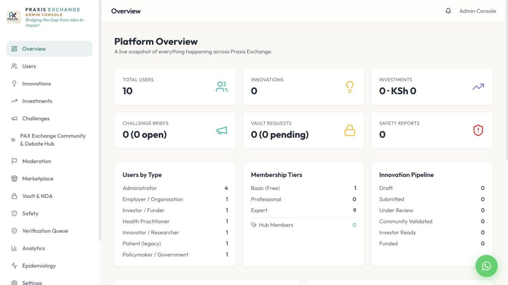

# PAX single-image Docker runbook

This runbook explains every step from the source checkout on an Apple-silicon Mac to an Ubuntu 24 server.
Commands are run from the PAX repository root unless a step says otherwise.

## 1. What is being deployed

There is one PAX application image and a separate PostgreSQL service:

```text
Internet -> HTTPS reverse proxy -> PAX app container -> PostgreSQL
                                    |-> notification worker
                                    |-> upload workers
                                    |-> privacy worker
                                    `-> Python scheduled safety jobs
```

`app`, `migrate` and `task` all use the exact same PAX image. This prevents the web process and background
jobs from drifting onto different code versions. PostgreSQL uses the official `postgres:18.4-bookworm`
image locally; production may use a managed PostgreSQL service or a separately managed container.

## 2. Files and their responsibilities

| File | Purpose |
|---|---|
| `Dockerfile` | Reproducible multi-stage build and the one final runtime image |
| `.dockerignore` | Excludes secrets, Git metadata, caches and local artifacts from build context |
| `docker/entrypoint.sh` | Reads mounted secret files and creates runtime-only environment variables |
| `compose.yaml` | Local app, migration task, PostgreSQL and reusable task runner |
| `compose.production.yaml` | Production app/migration/task definition for an external PostgreSQL database |
| `.env.docker.example` | Non-secret configuration template |
| `.github/workflows/container.yml` | Tests, multi-architecture build, GHCR publish, SBOM and provenance |

## 3. One-time local preparation on macOS

Verify Docker Desktop and Buildx:

```bash
docker --version
docker compose version
docker buildx version
docker info --format '{{.Architecture}}'
```

The last command normally prints `aarch64` on an M3. If `docker info` cannot connect, open Docker Desktop
and wait until the engine is running.

Create local configuration without committing secrets:

```bash
cp .env.docker.example .env.pax.local
mkdir -p .secrets
openssl rand -hex 32 > .secrets/postgres_password
openssl rand -base64 48 > .secrets/nextauth_secret
chmod 700 .secrets
chmod 600 .secrets/postgres_password .secrets/nextauth_secret
```

Edit `.env.pax.local` and add only the vendor settings you actually have. Leave unavailable integrations
blank. Never add `NEXTAUTH_URL`; the deployment environment supplies it. Never commit `.env.pax.local` or
`.secrets/`.

## 4. Protect an existing PostgreSQL database

Before importing or changing a database, take a custom-format backup:

```bash
mkdir -p "$HOME/pax-backups"
chmod 700 "$HOME/pax-backups"
pg_dump --format=custom --no-owner --no-acl \
  --dbname=pax_dev \
  --file="$HOME/pax-backups/pax_dev-before-docker.dump"
chmod 600 "$HOME/pax-backups/pax_dev-before-docker.dump"
```

The local Compose database listens only on `127.0.0.1:5433`; it does not overwrite PostgreSQL on the
Mac's usual port `5432`.

Start PostgreSQL and restore a backup only when the Docker database is empty:

```bash
docker compose up -d postgres
docker compose exec -T postgres pg_isready -U pax_app -d pax_dev
docker compose exec -T postgres pg_restore \
  --username=pax_app \
  --dbname=pax_dev \
  --no-owner \
  --no-acl \
  --clean \
  --if-exists \
  < "$HOME/pax-backups/pax_dev-before-docker.dump"
```

`pg_restore --clean` deletes objects in the target database, so use it only for a new/known disposable
Docker database. Never point this command at production.

## 5. Build and start locally

Build the native ARM64 image on the M3:

```bash
docker compose build app
```

Run migrations first, then start the web process:

```bash
docker compose up -d app
docker compose ps --all
docker compose logs --tail=100 migrate app
```

`app` depends on `migrate`. The web container does not start unless `yarn prisma migrate deploy` succeeds.
No destructive `prisma db push` or reset command is part of startup.

Seed the repeat-safe reference data and seven audit accounts:

```bash
docker compose run --rm task yarn prisma db seed
```

Open `http://127.0.0.1:3000` and check both health endpoints:

```bash
curl --fail http://127.0.0.1:3000/api/health/live
curl --fail http://127.0.0.1:3000/api/health/ready
```

Expected responses are `{"status":"ok"}` and `{"status":"ready"}`.

## 6. Run the complete local verification

The `quality` target is the same gate used by GitHub Actions:

```bash
docker build --target quality --tag pax:quality .
```

You can also verify the final runtime image directly:

```bash
docker compose run --rm task yarn prisma validate
docker compose run --rm task yarn typecheck
docker compose run --rm task yarn lint
docker compose run --rm task yarn test
docker compose run --rm task yarn notifications:work
docker compose run --rm task yarn uploads:scan
docker compose run --rm task yarn uploads:retention
docker compose run --rm task yarn privacy:retention
```

The final command is a dry run unless `--execute` is explicitly added. Do not add `--execute` in
production until the approved retention policies and backup are confirmed.

## 7. Prove Ubuntu compatibility from the M3

Ubuntu servers are commonly `linux/amd64`. Build that architecture explicitly:

```bash
docker buildx build \
  --platform linux/amd64 \
  --target runtime \
  --tag pax:amd64-test \
  --load \
  .

docker image inspect pax:amd64-test \
  --format '{{.Os}}/{{.Architecture}} user={{.Config.User}}'
```

Docker Desktop can run it through emulation for a final health check:

```bash
PAX_IMAGE_TAG=amd64-test docker compose up -d --force-recreate app
curl --fail --retry 20 --retry-all-errors http://127.0.0.1:3000/api/health/ready
PAX_IMAGE_TAG=local docker compose up -d --force-recreate app
```

The GitHub workflow publishes a manifest containing both `linux/amd64` and `linux/arm64`; Docker selects
the correct variant automatically when the server pulls it.

## 8. Publish through GitHub Container Registry

The repository already contains the workflow. The normal standard is to keep the Dockerfile and workflow
in the same Git repository as the application because an image must be traceable to its exact source commit.

1. Commit this branch and open a pull request.
2. Confirm the `Container` GitHub Actions check passes.
3. Merge into `main`.
4. GitHub automatically creates `ghcr.io/<owner>/<repository>:sha-<commit>`.
5. In the GitHub repository, open **Packages**, select the PAX package, and set its visibility and server
   access policy. Keep it private unless public distribution is intentional.
6. Prefer deploying the immutable digest printed by the workflow, for example
   `ghcr.io/<owner>/<repository>@sha256:<digest>`.

Useful official documentation:

- [GitHub Container Registry](https://docs.github.com/en/packages/working-with-a-github-packages-registry/working-with-the-container-registry)
- [GitHub package access control](https://docs.github.com/en/packages/learn-github-packages/configuring-a-packages-access-control-and-visibility)
- [Docker multi-platform builds](https://docs.docker.com/build/building/multi-platform/)

The workflow publishes an SBOM and provenance attestation. A third-party vulnerability scan can expose the
image's package inventory to that scanner; obtain approval before uploading a private image or inventory.

## 9. Prepare Ubuntu 24

Install Docker Engine from Docker's official Ubuntu repository rather than Ubuntu's older convenience
package: [Install Docker Engine on Ubuntu](https://docs.docker.com/engine/install/ubuntu/).

After installation:

```bash
sudo systemctl enable --now docker
sudo docker version
sudo docker compose version
sudo mkdir -p /opt/pax
sudo chown "$USER":"$USER" /opt/pax
cd /opt/pax
```

Copy only these operational files to `/opt/pax`:

```text
compose.production.yaml
.env.production
```

Use your server secret manager, not Git, to provision `.env.production`. It must contain `DATABASE_URL`,
`NEXTAUTH_SECRET`, the public application URL supplied by your hosting layer, and configured vendor values.
PAX application code must not hand-set `NEXTAUTH_URL`; inject it in the deployment platform/reverse-proxy
environment for the deployed hostname.

Restrict the file:

```bash
chmod 600 /opt/pax/.env.production
```

For a private GHCR package, create a fine-grained/read-only package token in GitHub and log in without
placing the token in shell history:

```bash
read -s GHCR_TOKEN
printf '%s' "$GHCR_TOKEN" | sudo docker login ghcr.io -u YOUR_GITHUB_USERNAME --password-stdin
unset GHCR_TOKEN
```

## 10. Deploy an immutable release

Set the exact image digest, pull, back up PostgreSQL, apply migrations, and start:

```bash
cd /opt/pax
export PAX_IMAGE='ghcr.io/OWNER/REPOSITORY@sha256:IMAGE_DIGEST'
export PAX_ENV_FILE='/opt/pax/.env.production'

sudo -E docker compose -f compose.production.yaml pull

pg_dump --format=custom --no-owner --no-acl \
  "$DATABASE_URL" \
  --file="/opt/pax/pax-before-$(date -u +%Y%m%dT%H%M%SZ).dump"

sudo -E docker compose -f compose.production.yaml run --rm migrate
sudo -E docker compose -f compose.production.yaml up -d app
sudo -E docker compose -f compose.production.yaml ps
curl --fail http://127.0.0.1:3000/api/health/live
curl --fail http://127.0.0.1:3000/api/health/ready
```

Do not use a floating `latest` tag. Record the deployed digest in the release notes.

Place Nginx, Caddy or your cloud load balancer in front of `127.0.0.1:3000`, terminate HTTPS there, and
forward the original host and protocol headers. The app port intentionally is not public.

## 11. Schedule jobs using the same image

Use systemd timers, your orchestrator, or cron. Each command is a one-shot container and must use the same
`PAX_IMAGE` and `PAX_ENV_FILE` as the web service:

```bash
sudo -E docker compose -f /opt/pax/compose.production.yaml run --rm task yarn notifications:work
sudo -E docker compose -f /opt/pax/compose.production.yaml run --rm task yarn uploads:scan
sudo -E docker compose -f /opt/pax/compose.production.yaml run --rm task yarn uploads:retention
sudo -E docker compose -f /opt/pax/compose.production.yaml run --rm task yarn privacy:retention --execute

sudo -E docker compose -f /opt/pax/compose.production.yaml run --rm task python3 shared/pax_signal_alerts.py
sudo -E docker compose -f /opt/pax/compose.production.yaml run --rm task python3 shared/pax_overdue_reminders.py
sudo -E docker compose -f /opt/pax/compose.production.yaml run --rm task python3 shared/pax_quarterly_surveillance.py
sudo -E docker compose -f /opt/pax/compose.production.yaml run --rm task python3 shared/pax_safety_archive.py
```

Use the schedules in `AGENTS.md`. Prevent overlapping runs at the scheduler level and alert on non-zero exit
codes. The archive and integration workers require the corresponding AWS/notification configuration.

## 12. Roll back

Application rollback is an image change, not a rebuild on the server:

```bash
export PAX_IMAGE='ghcr.io/OWNER/REPOSITORY@sha256:PREVIOUS_GOOD_DIGEST'
sudo -E docker compose -f /opt/pax/compose.production.yaml pull
sudo -E docker compose -f /opt/pax/compose.production.yaml up -d --force-recreate app
curl --fail http://127.0.0.1:3000/api/health/ready
```

Prisma migrations are forward-only. Before every migration release, confirm the migration is additive and
backwards-compatible with both the new and previous application image. Database restoration is a separate,
high-impact operation and should be used only from a verified backup with a documented recovery decision.

## 13. Screenshots from the verified local container

Desktop landing page:


Mobile landing page at 390 x 844:


Authenticated administrator console:



## 14. Stop local containers

Stop services while preserving the Docker database volume:

```bash
docker compose down
```

Deleting the named volume deletes the Docker database. Never run `docker compose down --volumes` unless
the database is disposable and a restore has been verified.
